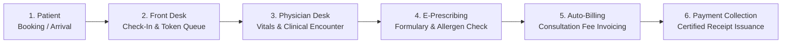
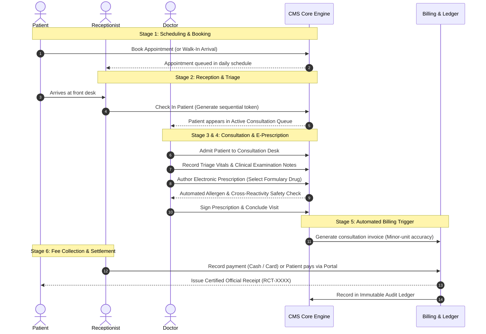
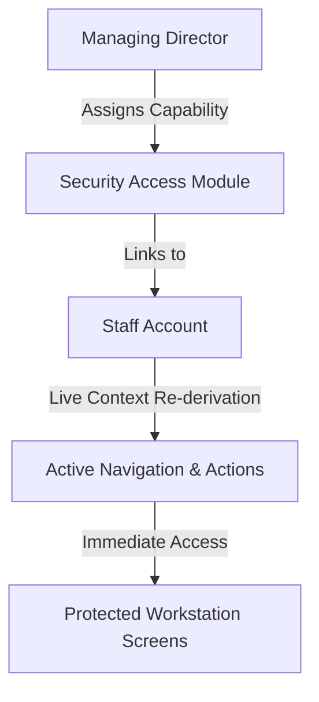
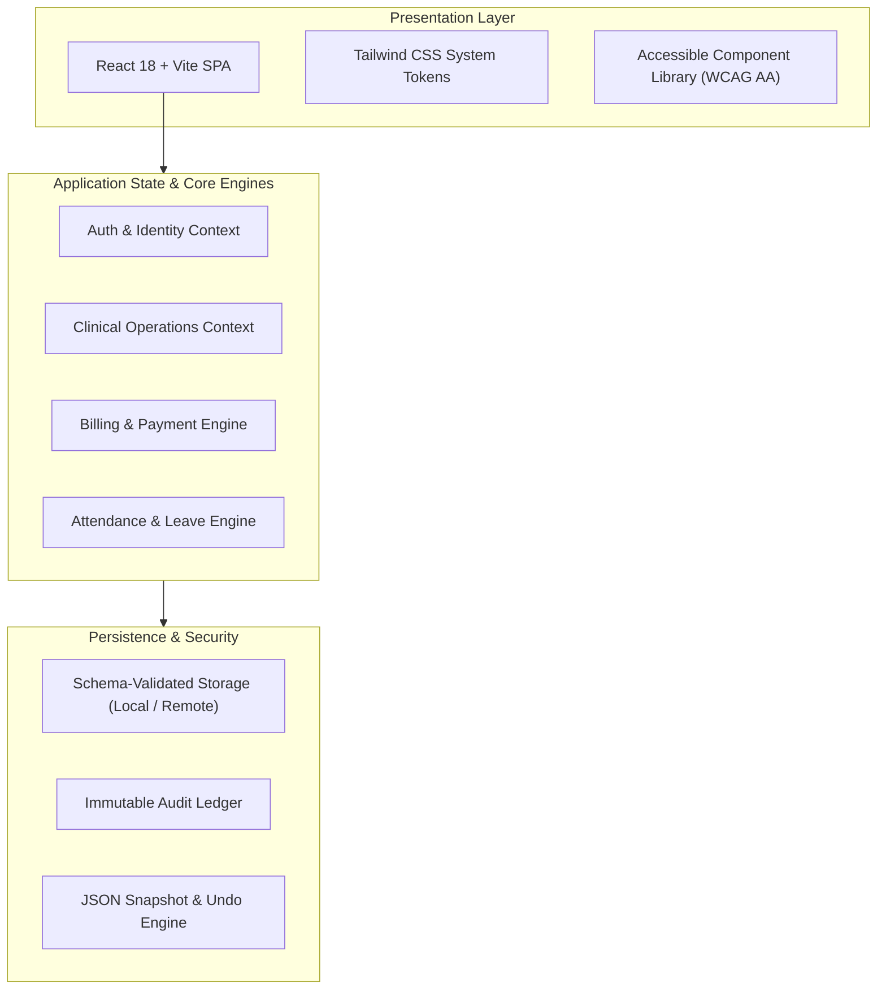

# Beacon Health Clinic Management System (CMS)
## Executive Project Workflow & Architecture Guide

---

## 1. Executive Summary

**Beacon Health Clinic Management System (CMS)** is an outpatient clinical and administrative operations platform designed to digitize and coordinate the complete outpatient healthcare journey. 

The system unifies four key stakeholders—**Patients**, **Front Desk Receptionists**, **Consulting Physicians**, and **Clinic Administrators/Managing Directors**—into a unified, role-based ecosystem. It eliminates operational bottlenecks between arrival triage, clinical consultations, electronic prescribing, fee billing, and regulatory governance.

---

## 2. Core Stakeholder Personas & Roles

| Role | Target User | Key Responsibilities & Capabilities |
| :--- | :--- | :--- |
| **Outpatient** | Registered Patient | • Self-service appointment scheduling with assigned doctors. • Real-time review of active medications and dosage regimens. • Online invoice review, balance payment, and certified receipt download. • Personal demographic and emergency contact management. |
| **Front Desk** | Receptionist / Intake Staff | • Arrival triage for booked visits and fast walk-in patient check-in. • Sequential token generation and live waiting lounge management. • Point-of-Sale (POS) fee collection (Cash/Card) with official receipts. • Daily intake registry tracking and attendance clock-in. |
| **Clinician** | Consulting Physician | • Queue-based patient admission to the consultation desk. • Clinical triage vitals entry (BP, Pulse, SpO2, Temperature). • Electronic prescription authoring with live drug formulary search. • Automated allergy and cross-reactivity safety alerts. • Encounter conclusion with automated billing trigger. |
| **Governance** | Managing Director / Admin | • Executive analytics (Patients, Visits, Revenue, Attendance KPIs). • Dynamic module creation and live staff permission elevation. • Drug formulary catalog and allergen rule maintenance. • Staff shift roster planning, leave approvals, and attendance audit. • Immutable security audit trail and data backup/restore. |

---

## 3. End-to-End Operational Lifecycle (Primary Workflow)

The outpatient lifecycle follows a standardized, six-stage workflow designed for clinical safety and financial accuracy:

### Detailed Breakdown of Each Stage:

### Stage 1: Patient Appointment & Arrival
1. **Advance Booking**: Patients can schedule consultations through their dedicated Patient Portal, selecting their preferred physician and time slot.
2. **Walk-In Registration**: For unscheduled visits, receptionists perform demographic-only registration at the front desk in under 30 seconds.

### Stage 2: Waiting Lounge & Token Dispatch
1. **Arrival Check-In**: The receptionist marks the patient as checked in.
2. **Token Queue**: A sequential daily token is issued, positioning the patient in the virtual waiting lounge.
3. **Caseload Routing**: The patient is routed directly to the designated physician's worklist.

### Stage 3: Clinical Consultation & Vitals Triage
1. **Patient Admission**: The physician clicks **Admit to Desk** to transition the patient from the waiting lounge to the active desk.
2. **Vitals Capture**: The clinician records core physiological markers:
   - Blood Pressure (Systolic / Diastolic)
   - Heart Rate (BPM)
   - Oxygen Saturation (SpO2 %)
   - Body Temperature (°C / °F)
3. **Clinical Notes**: The physician records symptoms, examination observations, and diagnostic findings.

### Stage 4: Formulary-Backed Electronic Prescribing (e-Rx)
1. **Formulary Lookup**: The physician selects medications from the standardized clinic drug catalog.
2. **Regimen Configuration**: Strength, dosage form (Tablet, Capsule, Inhaler), frequency, timing (before/after food), and duration are specified.
3. **Safety Cross-Checks**:
   - The engine validates selected drugs against patient recorded allergies.
   - If an allergy or cross-reactive drug class is detected, an explicit clinical warning is raised.
4. **Out-of-Formulary Safeguard**: If a non-formulary drug is prescribed, the physician must enter a mandatory clinical justification for auditing.

### Stage 5: Visit Conclusion & Automated Billing
1. **Encounter Closure**: Concluding the visit automatically updates the appointment status to **Completed**.
2. **Automated Invoicing**: The billing engine instantly generates an itemized invoice based on the physician's fee schedule.
3. **Minor-Unit Currency Storage**: All amounts are handled in minor units (e.g. ₹90.00 = 9000 paisa) to eliminate floating-point rounding errors.

### Stage 6: Fee Settlement & Certified Receipts
1. **Flexible Payment Points**: Fees can be collected in cash or card at the front desk, or settled online through the Patient Portal.
2. **Certified Receipts**: Upon settlement, the system issues a tamper-evident receipt (`RCT-YYYY-XXXX`) available for immediate printing or PDF export.
3. **Ledger Auditing**: The transaction is permanently committed to the clinic's immutable security audit ledger.

---

## 4. Key Subsystem Workflows

### A. Access Governance & Dynamic RBAC
The system features a live Role-Based Access Control (RBAC) architecture that allows administrators to grant or revoke capabilities without requiring users to log out.

- **Zero-Logout Live Updates**: Adding a staff member to a module (e.g., `paymentRecording`) instantly reveals billing controls in their browser session.
- **Segregated Dual-Audience Portals**: Dedicated portals for **Patients** and **Clinic Staff** prevent unauthorized cross-boundary access. If credentials are typed on the wrong portal, intelligent guidance redirects the user with one click without locking their account.

### B. Staff Attendance, Shifts & Leave Engine
- **Deterministic Shift Rostering**: Predefined shift timings with configurable grace periods (e.g., 15 minutes).
- **Automated Punctuality Status**: Real-time evaluation of staff arrival (`On Time`, `Late X min`, `Left Early`, `Shift not started`).
- **Clinical Cross-Coverage**: When a doctor requests leave, the system checks for scheduled patient appointments and coordinates cross-coverage with available staff.

### C. Standardized Clinical Drug Formulary
- **Categorized Directory**: Complete medication repository organized by therapeutic class, form, strengths, and active status.
- **Allergen Rules Matrix**: Cross-reactivity matching engine (e.g., Penicillin cross-reactivity with Cephalosporins).

---

## 5. Architectural & Technical Highlights

1. **High-Performance Architecture**: Built with React 18, TypeScript strict mode, and Vite 6 for rapid rendering and type safety.
2. **Accessibility-First Design**: Compliant with WCAG AA standards, featuring 44px minimum tap targets, full keyboard navigation with cyclic wrapping, and ARIA live announcements.
3. **Multi-Timezone Verification**: Verified across `UTC`, `America/Los_Angeles`, and `Asia/Kolkata` timezones to guarantee schedule and attendance consistency.
4. **Data Integrity & Backups**: One-click complete system JSON backup export, schema-validated restoration, and emergency rollback snapshots.

---

## 6. Manager Presentation Guide: 5-Minute Walkthrough Script

Use this structured script when demonstrating the platform to your manager:

### Minute 1: The Problem & The Solution
> *"Our project, the Beacon Health Clinic Management System, tackles the disconnect between outpatient front desk queues, doctor consultations, electronic prescriptions, and billing. Instead of using disconnected tools or paperwork, our system unifies the entire workflow into a single, responsive application."*

### Minute 2: Front Desk Intake & Queue (Demonstrate as Receptionist)
> *"We start at the Reception Desk as Priya Sharma. Here, a receptionist manages the live Waiting Lounge. When a patient arrives, we click 'Check In'. The system issues a sequential token and routes the patient directly to the doctor's consultation queue."*

### Minute 3: Clinical Encounter & Safety (Demonstrate as Doctor)
> *"Next, switching to Dr. Nathan Hayes, we see the patient in our queue. We click 'Admit to Desk'. We enter the patient's triage vitals and open the Electronic Prescription modal. As we select medications from the clinical formulary, the system actively scans the patient's allergy profile. If there's an allergy conflict or an off-formulary prescription, the system enforces safety alerts and clinical justifications."*

### Minute 4: Automated Billing & Payment (Demonstrate Billing Flow)
> *"Once the doctor concludes the visit, the consultation fee invoice is generated automatically. The receptionist can immediately record fee payment at the desk with cash or card, or the patient can pay securely through their self-service Patient Portal. Official receipts are issued with unique audit numbers and zero rounding errors."*

### Minute 5: Governance & Administrative Control (Demonstrate as Managing Director)
> *"Finally, as Managing Director Dr. Marcus Vance, we have complete executive oversight: 8 real-time KPI cards, staff attendance and leave tracking, live permission management without needing users to re-login, and an immutable security audit ledger that records every action for full compliance."*

---

## 7. Summary of Key Metrics & Deliverables

- **Test Suite Quality Gate**: 100% TypeScript strict verification across all modules.
- **Enterprise Design**: Uniform typography (`--fs-body`, `--page-pad`), dark/light theme support, and zero horizontal overflow.
- **Regulatory Readiness**: Strict separation of concerns, immutable audit trail, and clinical safety guardrails.

